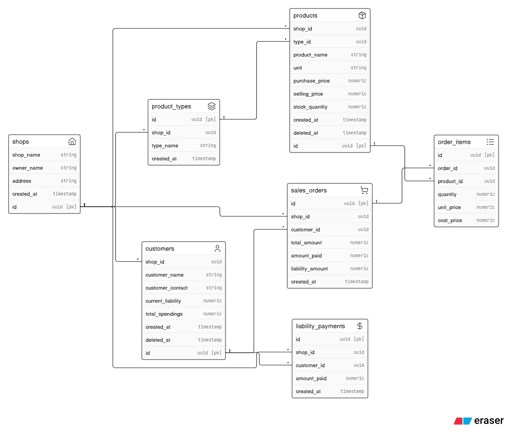

# Database Schema Design - Pak-Biz POS

This document contains the initial database schema design for the local retail POS system tracking Cash and Liability (*Udhaar*) sales.

## Visual ERD Diagram


## Eraser.io DSL Code
To edit or update this diagram, copy the syntax below into [Eraser.io](https://eraser.io):

```text

// ----------------------------------------------------
// Khata System v1: Final ERD
// ----------------------------------------------------

shops [icon: "home"] {
  id uuid [pk]
  shop_name string
  owner_name string
  address string
  created_at timestamp
}

product_types [icon: "layers"] {
  id uuid [pk]
  shop_id uuid
  type_name string
  created_at timestamp
}

products [icon: "package"] {
  id uuid [pk]
  shop_id uuid
  type_id uuid
  product_name string
  unit string               // piece | kg | dozen | litre
  purchase_price numeric (10,2)    // NUMERIC(12,2)
  selling_price numeric     // NUMERIC(12,2)
  stock_quantity numeric    // NUMERIC(12,3), decimals allowed
  created_at timestamp
  deleted_at timestamp      // soft delete
}

customers [icon: "user"] {
  id uuid [pk]
  shop_id uuid
  customer_name string
  customer_contact string
  current_liability numeric // updated only inside DB transactions
  total_spendings numeric
  created_at timestamp
  deleted_at timestamp      // soft delete
}

sales_orders [icon: "shopping-cart"] {
  id uuid [pk]
  shop_id uuid
  customer_id uuid          // NULLABLE: walk-in cash sales
  total_amount numeric
  amount_paid numeric
  liability_amount numeric  // = total_amount - amount_paid
  created_at timestamp
}

order_items [icon: "list"] {
  id uuid [pk]
  order_id uuid
  product_id uuid
  quantity numeric          // NUMERIC(12,3)
  unit_price numeric        // selling price snapshot
  cost_price numeric        // purchase price snapshot (for profit)
}

liability_payments [icon: "dollar-sign"] {
  id uuid [pk]
  shop_id uuid
  customer_id uuid
  amount_paid numeric
  created_at timestamp
}

// ---------------- Relationships ----------------
shops.id < product_types.shop_id
shops.id < products.shop_id
shops.id < customers.shop_id
shops.id < sales_orders.shop_id
shops.id < liability_payments.shop_id

product_types.id < products.type_id

sales_orders.id < order_items.order_id
products.id < order_items.product_id

customers.id < sales_orders.customer_id
customers.id < liability_payments.customer_id

```

## Core Relational Rules & Joins
- `sales_order.customer_id` is nullable to allow anonymous walk-in cash sales.
- `order_items` bridges the many-to-many relationship between orders and products.
- Check constraints ensure `selling_price >= purchase_price` to protect profit margins.
